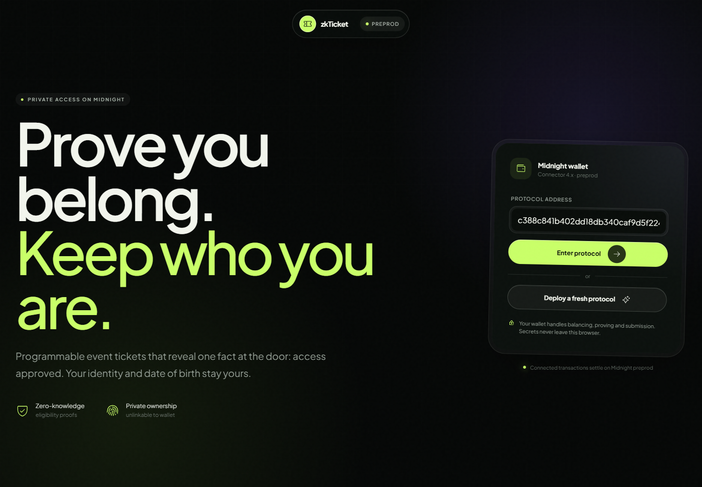

# zkTicket

> The venue learns that you are allowed inside—not who you are.

zkTicket is a privacy-first event access protocol built with Compact and Midnight.js. An attendee can buy a ticket, prove an age requirement, transfer ownership, and redeem a one-time entry credential without putting their name, email, exact date of birth, or wallet address into the ticket record.



## Why it exists

Conventional ticketing systems collect a profile when the door usually needs one answer: is this ticket valid for this event? zkTicket separates the minimum public state needed to operate an event from the private data needed to prove eligibility and ownership.

- Organizers get programmable capacity, pricing, lifecycle controls, redemption totals, and proceeds.
- Attendees keep ticket control behind a secret-derived commitment instead of a public wallet identifier.
- Door staff receive an on-chain admission decision without receiving an identity profile.

## Live preprod deployment

| Item | Value |
| --- | --- |
| Network | Midnight `preprod` |
| Web app | [https://zkticket.vercel.app](https://zkticket.vercel.app) |
| Compact contract | `79f31f558aa03e97cf66cab6b4f595e3f31597da7d0dca6faf15c88cf7f6cdee` |
| Deployment manifest | [`deployments/preprod.json`](deployments/preprod.json) |
| Wallet API | DApp Connector API `4.0.1` |
| Verified wallet | 1AM |
| Preferred proof service | Local `http://127.0.0.1:6300` (`8.1.0`) |

The UI ships with the contract address above as its preprod default.

## Implemented product flows

### Attendee

1. Choose an installed Connector API 4.x wallet (verified with 1AM; Lace is also detected) and connect on preprod.
2. Join the deployed protocol or deploy a fresh instance.
3. Buy a general or premium ticket with unshielded NIGHT.
4. Find the ticket locally by proving the event-scoped owner commitment.
5. Supply a date of birth as a private witness when the event has an age policy.
6. Generate a QR containing a freshly committed one-time entry secret.
7. Export an encrypted privacy-key backup for recovery on another device.

### Verifier

1. Scan the attendee QR with the camera or paste its payload.
2. Reject malformed, expired, wrong-network, or wrong-contract payloads locally.
3. Submit the temporary secret to the Compact redemption circuit.
4. Display access approval only after the on-chain transaction succeeds.
5. Reject every replay because the ticket is atomically marked as used.

### Organizer

1. Publish an event with an HTTPS artwork URL, venue, start time, age policy, capacity, tier prices, and transfer cap. The artwork URL is stored in the public event ledger and rendered on event and ticket views.
2. Pause or reopen ticket sales and close event entry.
3. Read issued, redeemed, revenue, and claimed-proceeds values from ledger state.
4. Claim settled NIGHT proceeds to the connected wallet's checksummed preprod address.

### Private transfer

The recipient generates an event-specific receiving commitment. The current holder submits that commitment on-chain. The old holder's secret no longer matches the ticket; the recipient's secret does. Transfer limits are enforced by the contract.

## What is public and private

| Public on Midnight | Private in the browser/proof witness |
| --- | --- |
| Contract and circuit called | dApp privacy key |
| Event name, venue, time, prices, status, and capacity | Exact date of birth |
| Ticket ID, event ID, tier, owner commitment, transfer count, and used flag | One-time entry secret before it is presented at the door |
| Aggregate revenue and claimed proceeds | The preimage behind organizer and ticket-owner commitments |
| Unshielded NIGHT payment and payout activity | Name, email, phone, government ID, and attendance profile—none are requested |

Unshielded NIGHT movements and transaction timing remain visible. A chain observer may correlate timing even though the ticket record does not contain the wallet address. Zero knowledge minimizes disclosure; it does not make all network metadata invisible.

## Privacy-key custody

The privacy key is generated with `crypto.getRandomValues`, scoped to a SHA-256 hash of the connected wallet address, and persisted locally so tickets remain accessible after refresh. Legacy preprod users are migrated from the original storage key without changing their on-chain identity.

The **My tickets → Recovery** panel creates an encrypted portable backup using:

- PBKDF2-HMAC-SHA-256 with 600,000 iterations;
- a fresh 16-byte salt;
- AES-256-GCM with a fresh 12-byte IV;
- authenticated decryption and strict 32-byte key validation.

Keep the backup separate from its passphrase. Clearing browser data without a backup permanently removes the local secret and therefore control of tickets and organizer commitments. Because a running script on the same origin can access browser storage, this preprod client should not be presented as hardware-wallet custody or used for mainnet value without a dedicated encrypted private-state provider and an independent security assessment.

## Architecture

| Directory | Responsibility |
| --- | --- |
| `contract/` | Compact source, witnesses, compiled circuit bindings/artifacts, and simulator tests |
| `api/` | Midnight.js deploy/join client, state decoding, transaction calls, input encoding, and payout-address decoding |
| `ui/` | React/Vite interface, wallet bridge, private-state recovery, QR generation/scanning, and product views |
| `proof-server/` | Pinned local proof-server configuration for wallets that do not provide a remote prover |
| `deployments/` | Network-specific contract addresses and live verification record |

```text
Attendee / Organizer / Verifier
              │
              ▼
      React client + private witnesses
              │
        DApp Connector API 4.x
              │
    ┌─────────┼──────────┐
    ▼         ▼          ▼
  Wallet   Proof service  Midnight indexer
    │                       │
    └─────────┬─────────────┘
              ▼
       zkTicket Compact contract
```

The marketing shell, QR encoder, and camera scanner are code-split. Midnight runtime and ledger WASM load only when a user connects, reducing initial-page work while preserving full browser-side proving support.

## Contract circuits

| Circuit | Purpose | Main assertions |
| --- | --- | --- |
| `createEvent` | Publish event configuration | Capacity > 0, transfer cap ≤ 8, coherent age policy |
| `setEventStatus` | Open, pause, or close an event | Event exists, organizer commitment matches |
| `buyTicket` | Receive NIGHT and create a private owner commitment | Event active, capacity available, exact tier price |
| `proveEligibility` | Prove ownership and optional age policy | Ticket unused, ownership match, DOB ≤ cutoff |
| `prepareEntry` | Commit a new one-time entry secret | Event not closed, ticket unused, ownership and age valid |
| `redeemTicket` | Admit once and burn replay path | Correct secret commitment, ticket unused, entry open |
| `transferTicket` | Replace the owner commitment | Ticket unused, owner valid, recipient differs, cap available |
| `claimEventProceeds` | Pay unclaimed NIGHT to a user address | Organizer valid, claim available, contract funded |

Commitment domains are separated (`organizer`, `owner`, and `entry`) and include the relevant event or ticket identifier where needed.

## Supported stack

- Compact compiler `0.31.1`, language `0.23`
- Compact runtime `0.16.0`
- Compact.js `2.5.1`
- Midnight.js `4.1.1`
- DApp Connector API `4.0.1`
- Ledger v8 `8.1.0`
- Proof server `8.1.0`
- React `19`, TypeScript `5.9`, Vite `7`
- Node.js `22+`

Runtime overrides intentionally align all Compact and Midnight.js consumers to `@midnight-ntwrk/onchain-runtime-v3@3.0.0` and `@midnight-ntwrk/ledger-v8@8.1.0`. Removing those overrides reintroduces incompatible WASM class instances.

## Run locally

Requirements: Node.js 22+, npm, a Connector API 4.x wallet set to preprod, and sufficient preprod NIGHT/DUST. Compact compilation also requires the Compact developer tools in WSL2 on Windows.

```powershell
npm install
npm run compile
npm run build
npm test
npm run typecheck
npm run dev
```

Open `http://localhost:3000`. Unlock 1AM or another compatible wallet, refresh if its connector was injected after the page loaded, then enter the default protocol.

### Optional local proof server

The browser client checks the pinned local prover first and uses the wallet-configured prover only when localhost is unavailable. This follows Midnight's privacy guidance because proving inputs can contain private witnesses. Start the local prover with:

```powershell
wsl -d Ubuntu -- bash /mnt/c/Users/parth/Desktop/zkTicket/proof-server/start.sh
```

Configure the wallet to use `http://127.0.0.1:6300`.

## Tests and release checks

```powershell
npm test               # Compact simulator + UI utility suites
npm run typecheck      # API and UI static checks
npm run build          # contract, API, and preprod production UI
npm audit --audit-level=low
```

The automated release suite includes **9 Compact simulator tests** and **16 UI utility tests** (25 total checks). Contract coverage includes event persistence (including the HTTPS artwork URL), exact payments, capacity, private age eligibility, invalid secrets, replay rejection, transfer invalidation, transfer caps, organizer authorization, lifecycle enforcement, and unfunded payout refusal. UI coverage includes QR scope/expiry/format validation, calendar and NIGHT encoding boundaries, encrypted privacy-key recovery, Connector 4.x discovery, duplicate-wallet handling, and synchronous wallet authorization. CI runs typecheck, tests, build, and `npm audit --audit-level=low` on every push and pull request.

Live preprod verification recorded in [`deployments/preprod.json`](deployments/preprod.json) covers deployment and synchronization, event creation, paid purchase, private eligibility, one-time entry preparation and redemption, replay refusal, sales pause/reopen, and settled organizer proceeds claim.

The hosted release at [zkticket.vercel.app](https://zkticket.vercel.app) scores **99 Performance** and **100 Accessibility, Best Practices, SEO, and Agentic Browsing** in Lighthouse. Its mobile audit reports zero horizontal overflow, and the Midnight runtime remains deferred until the user connects a wallet.

The pure Compact simulator cannot finalize `receiveUnshielded` effects into a later block, so the funded payout success path is verified on preprod while its authorization and insufficient-balance paths remain automated.

## Vercel deployment

The root [`vercel.json`](vercel.json) builds the contract bindings, API, and preprod UI from a clean checkout, serves `ui/dist`, caches circuit/WASM assets under a contract-versioned namespace, permits same-origin camera access, and applies CSP, frame, MIME, referrer, and opener protections. Increment `VITE_ZK_CONFIG_PATH` whenever the Compact schema or circuit logic changes so a browser can never combine a new circuit with stale immutable proving keys.

```powershell
npx vercel --prod
```

After deployment, verify the landing page without a wallet, then use a Connector-enabled browser to join the default contract and confirm preprod state. A wallet extension cannot be injected into a normal headless browser, so signed transaction flows are verified separately in the real extension-enabled browser.

## Known boundaries

- This release targets **preprod**, not Midnight mainnet.
- Ticket payments and organizer payouts use public, unshielded NIGHT.
- QR expiry is enforced by the official verifier UI; the contract enforces the stronger one-time commitment and irreversible redemption. A custom verifier can ignore wall-clock expiry.
- The remote proof-service operator processes proving inputs. Use a trusted or local prover according to your threat model.
- Event titles, venues, dates, tiers, capacity, commitments, and aggregate counts are public by product design.
- The repository has automated and live functional testing, but no claim of a third-party professional security audit.

## Production readiness

Current automated status:

- `npm run typecheck` passes for API and UI.
- `npm test` passes: 9 Compact simulator tests and 16 UI utility tests.
- `npm run build` passes for contract, API, and preprod UI.
- `npm audit --audit-level=low` passes with zero vulnerabilities.
- CI is defined in `.github/workflows/ci.yml`.

Before mainnet or real-value use, still required:

- third-party security audit of Compact circuits and browser custody;
- wallet-backed or encrypted private-state custody instead of browser `localStorage`;
- reconciliation of `deployments/preprod.json` with live verification evidence;
- production monitoring and incident response.

## Product roadmap

High-value next steps after this preprod release are wallet-backed encrypted private-state custody, seat/section commitments, organizer-configurable refund circuits, privacy-preserving allowlists, and separated verifier roles for multi-venue deployments. These are intentionally not mocked in the current UI: connected screens display only capabilities backed by the deployed contract.
